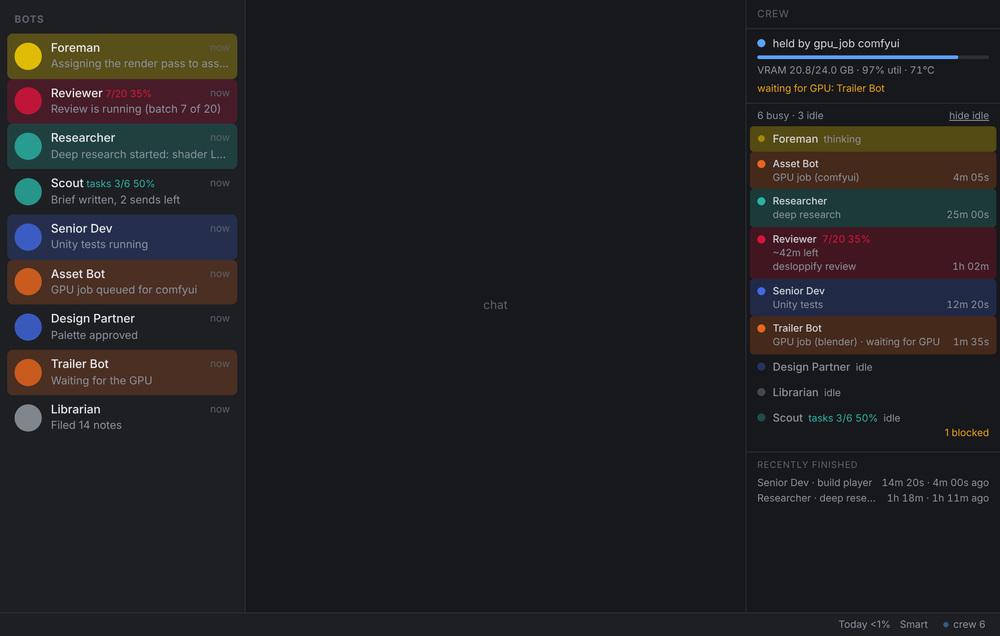
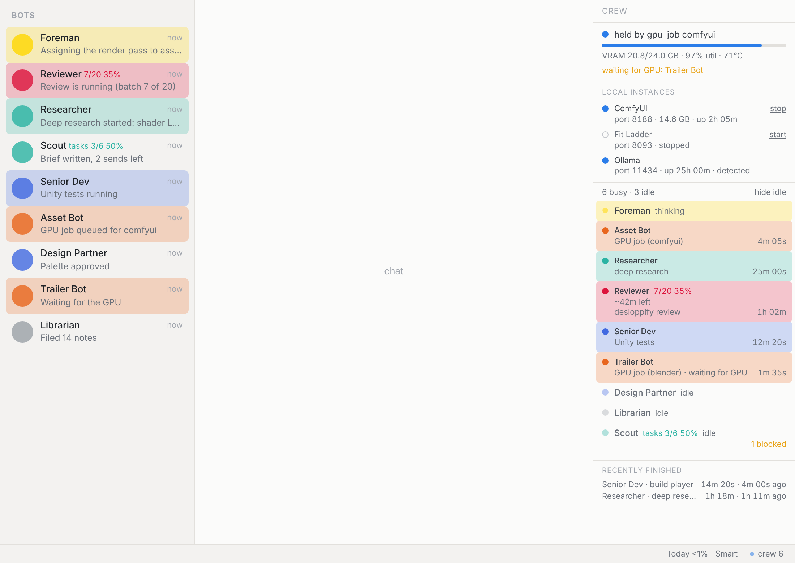
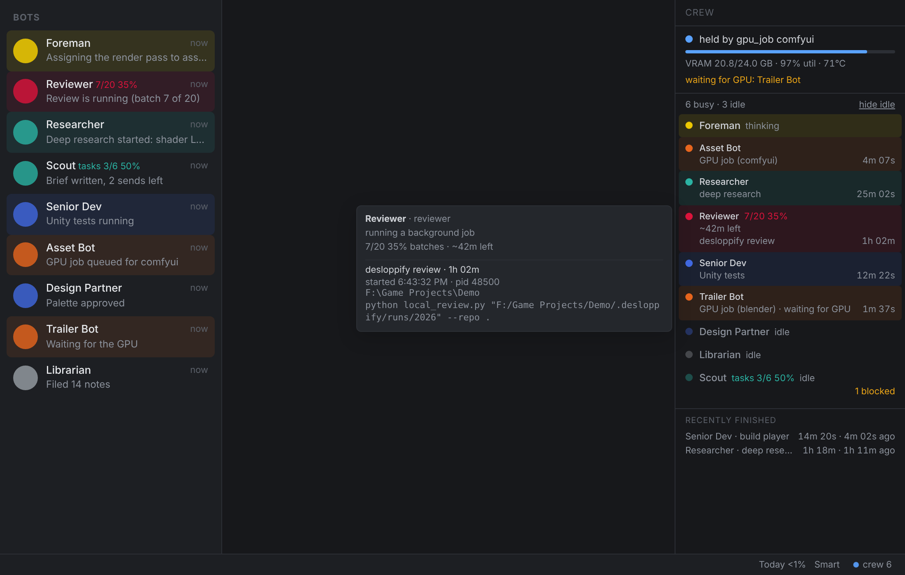
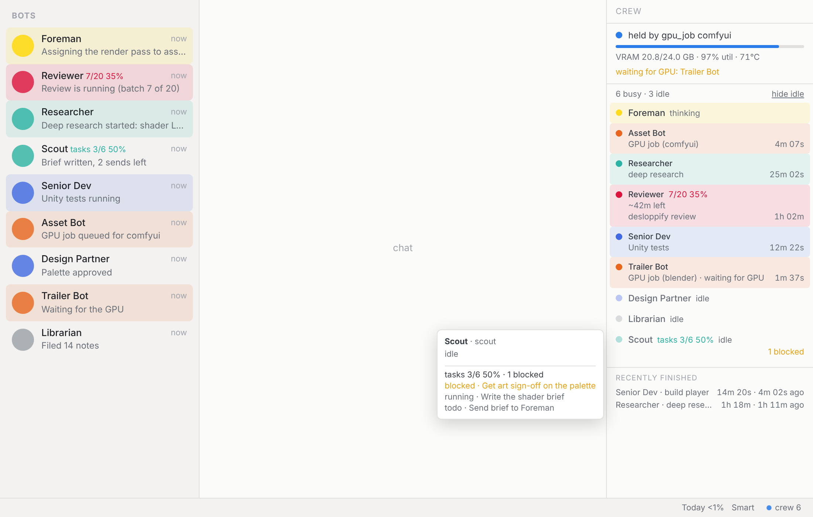

# Hermes Crew Monitor

A Hermes Desktop plugin: a panel beside the chat showing which bots are **thinking**, running a
**background job** (research, reviews, tests, renders...) or **idle**, with elapsed time, progress,
notifications when a job finishes, and a GPU line.

Why: bots start long jobs as background processes and end their turn, so the built-in "Active now"
strip shows them idle while the job still runs.

## What you see
- Top block: a VRAM bar with GPU utilisation and temperature (when `nvidia-smi` is present). With the
  optional Fit Ladder / `gpu_job` tools it also reads `Ladder 256K local · 21.5/24.0 GB`,
  `held by gpu_job comfyui` or `cloud fallback`, and lists who is waiting for the GPU.
- One row per bot with a coloured dot: pulsing = thinking, solid = background job (label + elapsed
  such as `desloppify review  1h 02m`), dim = idle, hollow = unknown (roster unreachable), amber =
  **waiting for you** (see Limits).
- Progress next to the name: review batches with an estimate (`7/20 35%`, `~42m left`), kanban tasks
  (`tasks 3/6 50%`, `1 blocked`). A job whose progress has not moved for 15 minutes reads `stalled`.
- **Recently finished**: the last jobs that ended, with how long they ran.
- Notifications: a job finished, a job stalled, a bot started waiting for you.
- `hide idle` in the panel. Click a row to open that bot's Bot Chat. The status-bar chip `crew N`
  (N = busy bots; hover it for who is doing what) toggles the panel.
- Command palette: **Crew Monitor: toggle panel**, **show or hide idle bots**, **toggle job
  notifications**, **log roster fields**.
- If the status service misses a few reads the panel says so and still shows thinking state.

## Screenshots
Rendered from the real `plugin/plugin.js` with invented data (no real sessions). The left list is a mock of
the core Bots rows; the plugin only styles them, it does not draw them. The page that makes them is
`docs/demo/index.html` (serve the repo root and open it).





Hover a row for details: job start, pid, folder and command line.



Bots with open kanban tasks list them.



## Install (Windows)
You need Hermes Desktop and Windows 10 or 11. Python comes with Hermes; if yours has none, install
Python 3.9 or newer from python.org. Nothing else is downloaded or installed.

1. Get the files: on GitHub choose **Code > Download ZIP** and unzip it anywhere, or
   ```powershell
   git clone https://github.com/Fablestarexpanse/hermes-crew-monitor.git
   ```
2. Open PowerShell in that folder (in File Explorer: Shift + right-click the folder > **Open
   PowerShell window here**) and run:
   ```powershell
   powershell -NoProfile -ExecutionPolicy Bypass -File install.ps1
   ```
3. Restart Hermes Desktop. The **Crew** panel appears to the right of the chat.

The installer finds your Hermes data folder by itself (`HERMES_HOME` if you set it, otherwise
`%USERPROFILE%\.hermes`). If it says it cannot find it, pass the folder that contains `profiles`:
```powershell
powershell -NoProfile -ExecutionPolicy Bypass -File install.ps1 -HermesHome "D:\Hermes\data"
```

What it does, all under your own user account (no administrator rights):
- copies `plugin/plugin.js` to `<Hermes data>\desktop-plugins\crew-monitor\`;
- copies the status service to `%LOCALAPPDATA%\HermesCrewMonitor\`, so the downloaded folder can be
  deleted afterwards;
- registers a logon task `HermesCrewMonitor` that keeps the service running (`127.0.0.1` only),
  starts it and checks that it answers.

To update, download the new version and run the same command again.

Other options: `-Port 8094` (use another port if 8094 is taken; the plugin is pointed at the same
one), `-Python <path to pythonw.exe>`, `-AllowOrigin <origin>` (see Safety).

### macOS and Linux
There is no installer yet and these are untested. By hand: copy `plugin/plugin.js` to
`~/.hermes/desktop-plugins/crew-monitor/plugin.js`, then keep this running (a login item, a
`systemd --user` unit, or just a terminal):
```bash
python3 service/crew_status.py --log ~/.hermes/crew-monitor.log
```
On these systems a reused process id cannot be told from the original job, so a finished job can
occasionally linger in the list.

## What works out of the box
- Every bot (Hermes profile) gets a row, named by its profile title. Thinking, idle, background jobs
  with elapsed time, kanban task progress, finished-job history and notifications need no setup.
- A background job is labelled with its command line unless a rule names it. Add your own names in
  Settings below.
- The GPU block shows VRAM, utilisation and temperature when `nvidia-smi` is on the machine, and is
  hidden otherwise.
- Built in for the author's own tools, harmless if you do not have them: labels for `local_review.py`
  (with batch progress and estimates), `research.py`, `gpu_job.py`, Unity test runs and bot-to-bot
  messages; the Fit Ladder line and GPU queue; colours for bots named foreman, reviewer, scout and so on.
  Other bots use the app's accent colour until you give them one.

## Settings
`%LOCALAPPDATA%\HermesCrewMonitor\crew-monitor.json`, re-read when it changes (no restart):
```json
{
  "stall_minutes": 15,
  "colors": { "scout": "#00ff88" },
  "rules": [
    { "match": "blender(\\.exe)?\\s+-b\\s+(\\S+)", "kind": "render", "label": "Blender render (\\2)" }
  ]
}
```
`rules` are regular expressions tried against a job's command line before the built-in labels;
`colors` override the built-in bot colours.

## Troubleshooting
- The panel is there but empty: the service is reading the wrong folder. Re-run the installer with
  `-HermesHome`; the log has a line saying so.
- No panel after restarting: check that `<Hermes data>\desktop-plugins\crew-monitor\plugin.js` exists
  and that desktop plugins are enabled in Hermes Desktop.
- Log: `%LOCALAPPDATA%\HermesCrewMonitor\crew-monitor.log`.
- `http://127.0.0.1:8094/health` shows the version, uptime and which page origins have connected.
- "Status service is version ..." in the panel: plugin and service are from different installs;
  re-run `install.ps1`.

## Uninstall
```powershell
powershell -NoProfile -ExecutionPolicy Bypass -File install.ps1 -Uninstall
```
Your `crew-monitor.json` is kept.

## Tests
`npm test` (JS logic with a stubbed SDK, then `python -m unittest discover -s service`). CI runs both
on Windows and Linux.

## Safety
- Read-only: writes no Hermes file; listens on 127.0.0.1 only; the only outbound calls are to the
  Ladder on 127.0.0.1 and `nvidia-smi`.
- Web pages cannot read it: requests whose `Origin` is an ordinary web site, or whose `Host` is not
  loopback (DNS rebinding), get 403. App shells (`app://`, `file://`, `null`) and loopback pages pass.
  `null` is also what a sandboxed iframe on a web page sends, so to close that too, look up Desktop's
  origin in `/health` (`origins_seen`) and re-run `install.ps1 -AllowOrigin <that origin>`.

## Limits
- **Waiting for you** depends on a field in Desktop's `profiles.list` rows that the SDK does not
  document. The plugin recognises the likely spellings (`pending_approval`, `needs_input`, a status
  like `awaiting_input`, ...). If it never lights up, run **Crew Monitor: log roster fields** and
  look in the developer console for the real field name.
- "Waiting for the GPU" is inferred: a live `gpu_job` that is not the lock holder.
- Estimates and "stalled" exist only for jobs with countable progress (desloppify batches).
- Finished-job history is in memory: it restarts with the service, and exit codes are not known.
- There is no click-through to the kanban board (no host API for it was found).

Design notes: `docs/FINDINGS.md`.
