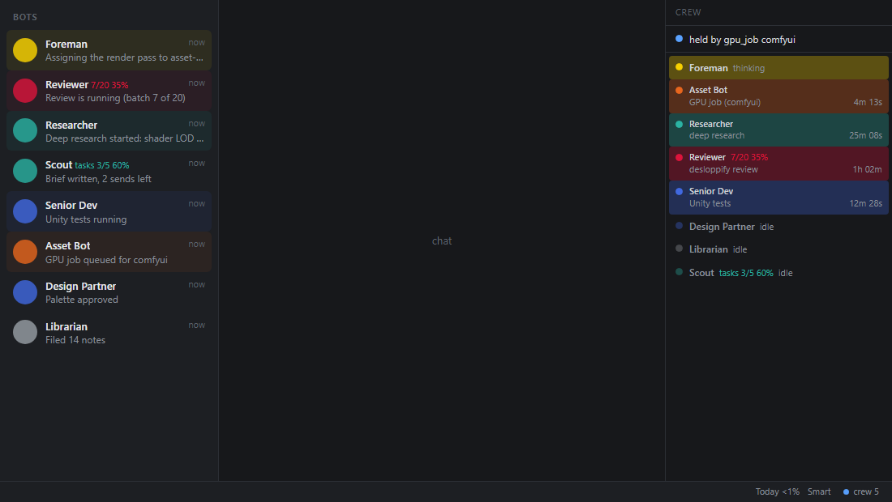
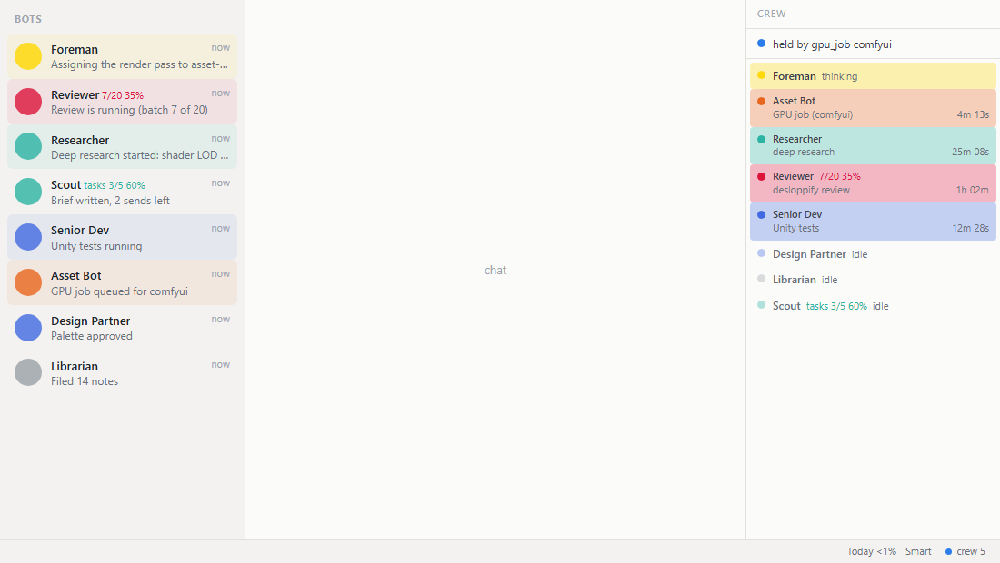
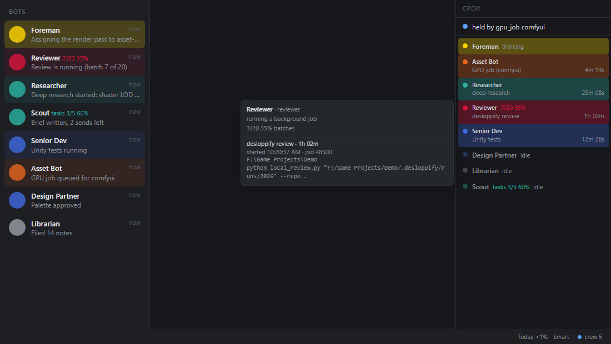
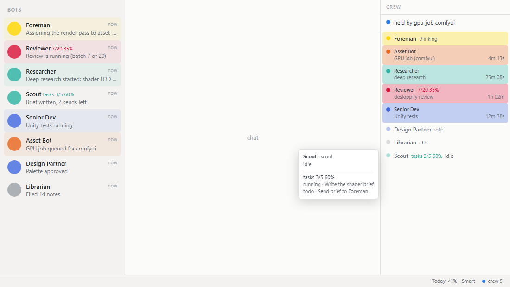

# Hermes Crew Monitor

A Hermes Desktop panel beside the chat showing which bots are **thinking**, running a **background
job** (deep research, desloppify review, Unity tests, renders...) or **idle**, with elapsed time, plus
a GPU line (Fit Ladder context / VRAM, or who holds the GPU).

Why: bots start long jobs as background processes and end their turn, so the built-in "Active now"
strip shows them idle while the job still runs.

## What you see
- Top line: `Ladder 256K local · 21.5/24.0 GB`, `held by gpu_job comfyui`, or `cloud fallback`.
- One row per bot with a coloured dot (foreman gold, researcher/scout seafoam, design-partner /
  senior-dev / editor-integrator royal blue, reviewer crimson, librarian grey, trailer-bot / asset-bot
  ember, gatekeeper mono): pulsing = thinking, solid = background job (label + elapsed such as
  `desloppify review  1h 02m`), dim = idle, hollow = unknown (roster unreachable).
- Click a row to open that bot's Bot Chat. Status-bar chip `crew N` (N = busy bots) and the command
  palette entry **Crew Monitor: toggle panel** show/hide the panel.
- If the status service is down the panel says so and still shows thinking state.

## Screenshots
Rendered from the real `plugin/plugin.js` with invented data (no real sessions). The left list is a mock of
the core Bots rows; the plugin only styles them, it does not draw them. The page that makes them is
`docs/demo/index.html` (serve the repo root and open it).





Hover a row for details: job start, pid, folder and command line.



Bots with open kanban tasks list them.



## Install
```powershell
powershell -NoProfile -ExecutionPolicy Bypass -File install.ps1
```
Copies `plugin/plugin.js` to `F:\Hermes\data\desktop-plugins\crew-monitor\`, registers the per-user
logon task `HermesCrewMonitor` (limited rights, stdlib Python, `127.0.0.1:8094` only), starts it and
checks `/crew`. Then restart Hermes Desktop.

## Uninstall
```powershell
powershell -NoProfile -ExecutionPolicy Bypass -File install.ps1 -Uninstall
```

## Tests
`npm test` (JS logic with a stubbed SDK) and `python -m unittest discover -s service` (process
classifier, stale/reused-pid filtering, job ownership, GPU labels).

## Safety
Read-only: writes no Hermes file; no network beyond 127.0.0.1. Design notes: `docs/FINDINGS.md`.
